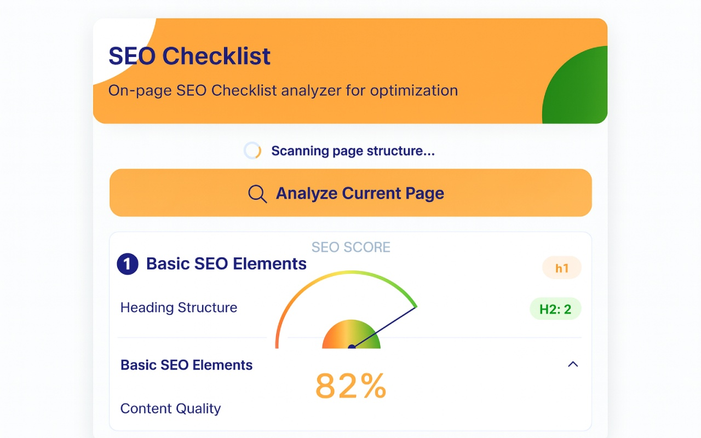
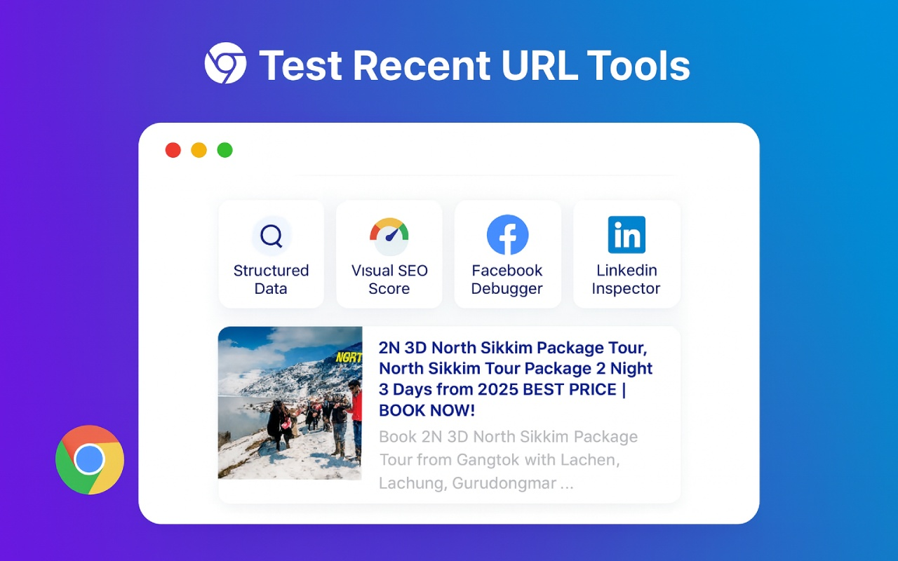
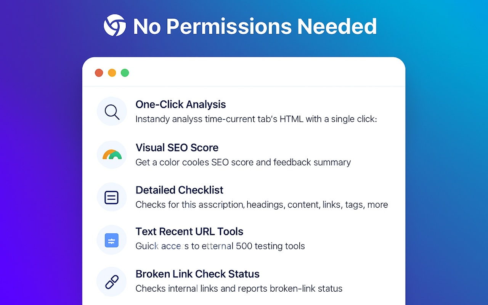

# SEO Checklist v1.5 – On-Page SEO Analyzer Chrome Extension

SEO Checklist is a modern, privacy-friendly Chrome extension that provides instant, client-side on-page SEO analysis for any website you visit. It gives you a clear, actionable checklist and visual feedback to help you optimize your pages for search engines—no server, no data collection, and no access to your websites at install.

---

## Install from Chrome Web Store

[**Install SEO Checklist from the Chrome Web Store**](https://chromewebstore.google.com/detail/seo-checklist/jgigdhidhmgikfnccdnehcpgoggmagfh?hl=en-GB&authuser=0)

---

## What’s New in v1.5 (November 2026)

- **No More "Read and Change All Your Data" Warning**: Broad website access and notifications are removed. The extension only reads the tab you analyze, when you click.
- **Broken Link + Image Checks Without Extra Permissions**: Internal links and same-site images are now checked from the analyzed page itself.
- **Optional External Checks**: Click "Check external links and images" to also check links and images on other domains. Chrome asks once; you can remove the access anytime.
- **Google-Accurate Title and Description Lengths**: Measured in pixels (about 580px for titles, 920px for descriptions), the way Google cuts them off.
- **Fairer Content Length Check**: Thin-content warning below 300 words. Menus, headers, footers and scripts no longer count as content.
- **Accurate Google Analytics Detection**: Detects GA4 / Tag Manager and shows the tag IDs. Search Console verification tags no longer count as analytics.
- **Lazy-Loaded Images**: Images using `data-src` / `srcset` are now included.
- **Friendlier Messages**: Errors show inside the popup instead of browser alerts. A one-time "What's new" banner replaces the update notification, and the update page only opens for new releases (not patches).

## What’s New in v1.4 (March 2026)

- **More Exact SEO Score (Web-Vitals-Inspired Signals)**: Scoring is now more granular with additional technical quality signals such as heading order, discernible link names, image dimension checks, and image optimization scope.
- **Heading Order Validation**: Detects skipped heading levels (for example H2 to H4) to catch structural issues.
- **Internal / External Link Insights**: Added dedicated internal and external link breakdown with detailed lists in the analysis panel.
- **Printable SEO Report / PDF Export**: Export analysis to a printable report and save as PDF.
- **Discernible Link Names Check**: Flags links without visible text or accessible labels.
- **GA Tag + Image Optimization Scope**: Improved technical scoring with analytics tag detection and image-size based optimization scope classification.
- **Image Optimization Opportunities**: New section with size-based recommendations (including compression and format guidance).
- **Restricted URL Guard**: Prevents analysis attempts on non-injectable pages like `chrome://`, extension pages, and other protected URLs.
- **Safer Social Preview Loading**: Social preview now skips restricted tabs and falls back to a placeholder without runtime errors.
- **Improved Popup Stability**: Added explicit Chrome API error handling for safer execution.

---

## Changelog

### v1.5 (November 2026)

- Removed `host_permissions` and `notifications`; added `storage` (for the one-time "What's new" banner) and optional host permissions for external checks.
- Moved broken-link and image-size checks into the analyzed page so they work with `activeTab` only.
- Added opt-in external link and image checks.
- Title and meta description checks now use pixel width.
- Content length: warning below 300 words; non-content elements excluded.
- Fixed Google Analytics false positives; shows detected GA4/UA/GTM IDs.
- Included lazy-loaded images in image checks.
- Replaced `alert()` popups with in-popup messages.
- Renamed "Test Recent URL" to "Test This Page In…".
- Update page opens only when the release line changes (e.g. 1.4 → 1.5), not for patches.

### v1.4 (March 2026)

- Added more exact SEO scoring with expanded technical checks and weighted warning handling.
- Added heading order validation for skipped heading levels.
- Added discernible link name detection for accessibility-focused SEO quality.
- Added internal and external link overview panels with detailed lists.
- Added printable report export flow (Print / Save as PDF).
- Added image optimization opportunities with scope and recommendations.
- Added image attribute issue reporting (missing alt and width/height).
- Improved GA tag and technical signal coverage in score inputs.
- Added guarded analysis for supported page types (`http/https` only).
- Fixed popup error flow for restricted URLs.
- Improved social preview fallback behavior on protected pages.

### v1.3 (March 2026)

- **Social Preview Analyzer**: Instantly preview Open Graph and Twitter-style title, description, image, and URL metadata.
- **Quick SEO Testing Tool Launcher**: Open Rich Results Test, PageSpeed Insights, Facebook Sharing Debugger, and LinkedIn Post Inspector with one click.
- **Broken Link Visibility**: Better internal-link quality checks with status feedback in the popup.
- **Performance + Workflow Benefits**:
  - Reduce manual QA time for technical SEO checks.
  - Catch metadata and sharing-preview issues before publishing.
  - Validate on-page SEO and off-page sharing readiness from one extension.

---

## Features

- **Minimal, Purpose-Built Permissions**: Uses `activeTab` + `scripting` for on-page analysis and `storage` for the one-time "What's new" message. Access to other sites is optional and only requested if you check external links. All analysis remains client-side.
- **One-Click Analysis**: Instantly analyze the current tab’s HTML with a single click.
- **Visual SEO Score**: Get a color-coded SEO score and feedback summary using expanded technical checks (web-vitals-inspired scoring signals).
- **Detailed Checklist**: Checks for:
  - Title tag length (fits in ~580px, like Google)
  - Meta description length (fits in ~920px, like Google)
  - Heading structure (1 H1, multiple H2s)
  - Heading order (no skipped heading levels)
  - Content length (thin-content warning under 300 words)
  - Image alt texts
  - Internal links
  - External links
  - Discernible link names
  - Mobile viewport tag
  - Canonical tag
  - Schema markup
  - Google Analytics / GA Tag implementation
  - Image dimensions and optimization scope
- **Color-Coded Status**: Good, Warning, and Needs Work indicators for each check.
- **Tooltips**: Hover for actual content and recommendations.
- **Accordion UI**: Expand/collapse categories for a clean, modern look.
- **Loading Indicator**: See when analysis is running.
- **Google Analytics Detection**: Detects if Google Analytics or Google Tag Manager is installed on your page
- **Social Preview Card**: Preview social metadata (title, description, image, URL) directly in the extension popup.
- **Internal / External Link Overview**: Review separated internal and external link lists directly in the popup.
- **Broken Link Check Status**: Checks internal links automatically, and external links on request.
- **Discernible Link Names Audit**: Detects links with missing visible text or accessible naming.
- **Image Attribute Issues Panel**: Lists images missing alt text and/or width/height attributes.
- **Image Optimization Opportunities**: Provides image-size based scope and optimization recommendations.
- **Printable Report Export**: Open a dedicated report view and print or save as PDF.
- **Test This Page In… Tools**: Quick access to external SEO testing tools:
  - **Structured Data / Rich Results** – Test with Google's Rich Result Testing Tool
  - **Google PageSpeed Insights** – Analyze page performance and loading speed
  - **Facebook Sharing Debugger** – Preview how your page appears when shared on Facebook
  - **LinkedIn Post Inspector** – Preview how your page appears when shared on LinkedIn
  - Each tool opens in a new tab with your current page URL automatically pre-filled
- **Works on Most Pages**: (Not available on Chrome Web Store, extensions, or `chrome://` pages due to browser restrictions.)

---


## Manual Installation (Development)

1. **Clone or Download this Repository**
2. **Open Chrome and go to** `chrome://extensions/`
3. **Enable "Developer mode"** (top right)
4. **Click "Load unpacked"** and select the extension folder (containing `manifest.json`)

---

## Usage

1. Visit any website you want to analyze.
2. Click the SEO Checklist extension icon in your Chrome toolbar.
3. Choose your action:
   - **Analyze Current Page** – Perform a detailed on-page SEO analysis with scoring and checklist
   - **Test This Page In…** – Use external SEO tools to test your page:
     - Click **Structured Data** to test rich snippets and schema markup with Google's tool
     - Click **PageSpeed Insights** to check performance metrics and optimization suggestions
     - Click **Facebook Debugger** to preview page sharing appearance on Facebook
     - Click **LinkedIn Inspector** to preview page sharing appearance on LinkedIn
4. Review detailed technical panels including heading order, link quality, broken internal links, and image optimization opportunities.
5. Click **Export PDF Report** to open the printable report view, then print or save as PDF.

## Screenshots

<p align="center">
  
  
  
  
  
</p>

---

## How It Works

- Uses the [Chrome Extensions Manifest V3](https://developer.chrome.com/docs/extensions/mv3/intro/) API.
- Injects a script into the active tab to fetch the page’s HTML.
- Parses and analyzes the HTML in the popup—**no data is sent anywhere**.
- Displays results in a modern, interactive UI.

---

## File & Folder Structure for Chrome Web Store Upload

Only include the following files/folders in your upload ZIP:

```
SEO Checklist/
│   LICENSE
│   manifest.json
│   background.js
│   popup.html
│   popup.css
│   popup.js
│   report-print.js
│
└───icons
  icon16.png
  icon48.png
  icon128.png
```

Do **not** include `marketing/`, `planning/` or `screenshots/` folders in the upload ZIP. Upload screenshots and promo images separately in the Chrome Web Store dashboard.

---

### Key Files

- **manifest.json** – Extension configuration and permissions
- **background.js** – Update handling (release page + "What's new" flag)
- **popup.html** / **popup.css** – Extension popup UI
- **popup.js** – Main logic for fetching and analyzing the page
- **report-print.js** – Print / Save as PDF helper for the report view
- **icons/** – Extension icons

### Permissions

```json
"permissions": [
  "scripting",
  "activeTab",
  "storage"
],
"optional_host_permissions": [
  "http://*/*",
  "https://*/*"
]
```

The optional host permissions are not granted at install. Chrome only asks for them if you click **Check external links and images**, and you can remove them anytime on the extension's details page.

---

## Limitations

- **Cannot analyze Chrome Web Store, extensions, or `chrome://` pages** (browser security restriction).
- **Some sites may block script injection** (e.g., with CSP headers).
- **SEO checks are basic and for guidance only**—always combine with manual review and other tools.

---

## Privacy

SEO Checklist does **not** collect, store, or transmit any data. All analysis is performed locally in your browser.

---

## License

MIT License

---

## Credits

- UI inspired by modern design aspects.
- Built with [Chrome Extensions API](https://developer.chrome.com/docs/extensions/).

- **Developer:** [Anupam Mondal](https://anupammondal.in)


